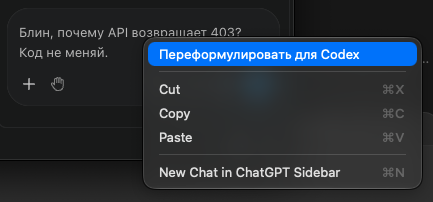

# CalmCodex

**Из живой речи — в ясную задачу для Codex.**

Надиктовывайте задачу так, как она возникает в голове: с уточнениями, повторами и эмоциями. CalmCodex помогает собрать из этого понятное сообщение для Codex — с целью, контекстом и ограничениями.

Работает прямо в поле ввода Codex в VS Code на macOS: при обычной отправке или через предварительный просмотр.

[Скачать для macOS](https://github.com/Vitykovskiy/CalmCodex/releases/latest) · [Инструкция](docs/installation.md) · [Предложить улучшение](https://github.com/Vitykovskiy/CalmCodex/issues)

## Как это выглядит

### Из диктовки — в постановку задачи

Режим **Подготовить промпт для Codex**.

**Вы надиктовали:**

> Так, с сохранением беда. Нажимаю кнопку один раз — три записи. Почини это. API оставь как есть. И никаких новых зависимостей. Нужна одна запись на нажатие.

**Запрос для Codex:**

> Исправь сохранение: одно нажатие кнопки должно создавать одну запись вместо трёх. Сохрани API. Новые зависимости не добавляй.

В запросе собраны проблема, ожидаемое поведение и границы изменений.

### Из раздражения — в конкретную обратную связь

| Черновик | Реплика для Codex |
| --- | --- |
| Я просил только выровнять кнопку. Кто тебя просил переписывать весь экран? | Ограничь изменения выравниванием кнопки. |
| Я для красоты указал требование «без новых зависимостей»? И объясни, почему `etag` пуст. Код пока не меняй. | Соблюдай требование «без новых зависимостей». Объясни, почему `etag` пуст. Код пока не меняй. |

Примеры иллюстрируют правила обработки; конкретная формулировка зависит от модели.

## Два режима

| Режим | Для чего |
| --- | --- |
| **Переформулировать для Codex** · `rewrite` | Убрать эмоциональный шум, выразить ясный упрёк как требование, сохранить настоящие вопросы и ограничения. |
| **Подготовить промпт для Codex** · `prompt` | Организовать черновик в постановку задачи: цель, контекст, границы работы и описанный результат. |

По умолчанию используется `rewrite`. Чтобы готовить промпт при каждой отправке, выберите `calmCodex.mode = prompt` в настройках VS Code. Обе команды доступны по правому клику независимо от режима автоматической обработки.

Правила рассчитаны на сохранение намерения: просьба объяснить остаётся просьбой объяснить, а требование «код не меняй» сохраняет силу. Код, пути и цитаты защищены от изменения. [Подробнее о подготовке промпта и её источниках](docs/prompt-mode.md).

## Установка на Mac

1. Установите расширение Codex для VS Code и войдите в аккаунт с доступом к модели.
2. [Скачайте последний релиз](https://github.com/Vitykovskiy/CalmCodex/releases/latest), распакуйте `CalmCodex-macOS.zip` и откройте `Install.command`.
3. Если окно VS Code уже открыто, выполните **Developer: Reload Window** через **⌘⇧P**.

Пишите или диктуйте сообщение и отправляйте его обычным способом. Для просмотра результата перед отправкой выберите нужную команду по правому клику в поле ввода. С выделением обрабатывается выбранный фрагмент, без выделения — весь черновик. Изменения можно отменить обычной командой отмены.



Параметр `calmCodex.rewriteOnSend` управляет автоматической обработкой. При сбое модели исходный черновик сохраняется. Установщик также добавляет службы для редактируемых текстовых полей других приложений macOS.

Обработку выполняет модель через текущий вход в Codex. Ей передаётся черновик; работа с кодом и контекстом проекта продолжается в вашем обычном диалоге Codex. Выбор модели, удаление и установка только расширения описаны в [инструкции](docs/installation.md).

## Помочь развитию

Самый полезный пример — реплика, в которой потерялось ваше намерение. [Создайте issue](https://github.com/Vitykovskiy/CalmCodex/issues/new): приложите исходный черновик, полученный результат, режим обработки и объяснение того, что должно сохраниться.

Направления для вклада:

- **Сложные формулировки:** сарказм, самоисправления, смешанные вопросы и требования, разные языки.
- **Правила и проверки:** улучшение режимов, сохранение ограничений, кода и форматирования.
- **Новые интеграции:** другие редакторы и способы ввода, удобство предварительного просмотра и снижение задержки.

Для изменения правил начните с файлов промптов и примера, на котором хотите улучшить результат. Проверяйте также соседние случаи: например, риторический упрёк и настоящий вопрос с похожими словами.

## Разработка

Нужны macOS, Xcode Command Line Tools и Node.js 22 или новее. Из корня репозитория:

```sh
npm ci
npm test
npm run build
```

Сборка создаёт `dist/CalmCodex.vsix` и `dist/CalmCodex-macOS.zip` со службой для Apple Silicon и Intel. Основные тесты проверяют редактор и Swift-обработку текста без обращения к модели.

| Что меняете | Где искать |
| --- | --- |
| Правила редактирования и подготовки промпта | [editor.txt](macos/Resources/editor.txt), [prompt.txt](macos/Resources/prompt.txt) |
| Выбор режима в CLI и службах macOS | [ProcessingMode.swift](macos/Sources/ProcessingMode.swift) |
| Защита цитат, путей и кода | [Draft.swift](macos/Sources/Draft.swift) |
| Запуск модели и обработка ошибок | [Rewrite.swift](macos/Sources/Rewrite.swift) |
| Отправка, диктовка и предварительный просмотр в VS Code | [composer.mjs](extension/composer.mjs) |
| Подключение к конкретной версии Codex | [install-adapter.cjs](extension/install-adapter.cjs) |
| Установка и удаление | [installer/](installer/) |

CalmCodex добавляет обратимый адаптер в локальную копию расширения `openai.chatgpt`. После обновления Codex выполните `npm run test:adapter` для проверки установки и удаления на временной копии. Адаптер проверен с Codex `26.1120.50957` и VS Code `1.147.0`.

`npm run test:live` проверяет переформулирование через установленный CalmCodex. `npm run test:live:prompt` проверяет подготовку промпта на текущей сборке; порядок запуска описан в [руководстве режима](docs/prompt-mode.md). Эти проверки обращаются к модели и используют лимит текущего аккаунта Codex.
